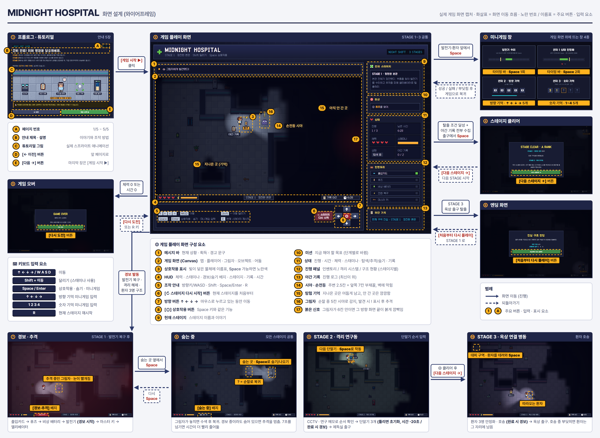

# MIDNIGHT HOSPITAL

정전된 한밤의 병원에서 그림자를 피해 세 구역을 차례로 빠져나가는 2D 도트 탈출 게임입니다. 2학년 프로그래밍 수행평가로 만들었습니다.

바로 플레이: https://suhang.streamlit.app/

## 프로젝트 소개

플레이어는 야간 근무 중이던 의료진입니다. 갑작스러운 정전과 시스템 오류로 병원 출입문이 모두 잠겼고, 복도에는 그림자가 돌아다닙니다. 제한 시간 안에 물품을 찾고 장치를 복구해서 본관, 격리 연구동, 옥상 연결 병동을 순서대로 통과하면 탈출합니다.

스테이지마다 탈출하는 방법이 다릅니다. 1스테이지에서는 부품을 모아 발전기를 고치고, 2스테이지에서는 단말기 세 개를 정해진 순서로 켜고, 3스테이지에서는 환자 세 명을 찾아 대피 구역까지 데려옵니다.

게임 화면과 동작은 HTML Canvas, CSS, JavaScript로 만들었고, Python의 Streamlit으로 웹 페이지에 띄웁니다.

## 화면 설계

실제 게임 화면을 캡처해서 만든 와이어프레임(v2)입니다. 화살표는 화면이 넘어가는 흐름이고, 노란 번호와 이름표는 버튼과 입력 요소입니다. 이미지를 누르면 크게 볼 수 있습니다.



화면은 프롤로그·튜토리얼, 게임 플레이, 미니게임 창, 스테이지 클리어, 게임 오버, 엔딩으로 이루어져 있습니다.

## 사용법

### 조작

| 키 | 동작 |
|---|---|
| 방향키 또는 `W` `A` `S` `D` | 이동 |
| `Shift` + 이동 | 달리기 (스태미나 소모) |
| `Space` 또는 `Enter` | 물건 줍기, 장치 작동, 숨기와 나오기, 타이밍 미니게임 입력 |
| 방향키 | 방향 기억 미니게임 입력 |
| `1` `2` `3` `4` | 숫자 기억 미니게임 입력 |
| `R` | 현재 스테이지 다시 시작 |

화면 아래에 있는 방향 버튼, 상호작용 버튼, 다시 시작 버튼을 마우스로 눌러도 됩니다. 키보드가 반응하지 않으면 게임 화면을 한 번 클릭하면 됩니다.

### 진행 순서

1. 안내 5장을 넘기고 마지막 장에서 `게임 시작`을 누릅니다.
2. 화면 오른쪽 `미션` 칸에서 지금 해야 할 일을 확인합니다.
3. 물건이나 장치 가까이 가서 `Space`를 누릅니다.
4. 스테이지 목표를 끝내고 그 구역의 야간 기록 2개를 모두 주운 다음, 출구에서 `Space`를 누르면 다음 스테이지로 넘어갑니다.
5. 체력이 0이 되거나 제한 시간이 끝나면 게임 오버이고, 그 스테이지를 처음부터 다시 합니다.

| 스테이지 | 제한 시간 | 목표 | 출구 |
|---|---|---|---|
| 1. 정전된 본관 | 7분 10초 | 출입카드, 퓨즈, 비상 배터리를 찾아 발전기를 수리하고 마스터 키 획득 | 엘리베이터 |
| 2. 격리 연구동 | 6분 40초 | 연구 메모나 CCTV에서 순서를 확인하고 단말기 A, B, C를 그 순서대로 작동 | 제독실 출구 |
| 3. 옥상 연결 병동 | 8분 40초 | 환자 3명을 안정화하고 한 명씩 대피 구역으로 호송 | 옥상 출구 |

## 주요 기능

### 손전등 시야

플레이어 주변 2.5칸과 바라보는 방향 7칸까지만 밝게 보입니다. 빛은 벽을 통과하지 못합니다. 한 번 지나간 곳은 어둡게 남고, 가 보지 않은 곳은 보이지 않습니다.

### 그림자 추적

그림자는 정해진 길을 순찰하다가 앞쪽 5칸 안에 플레이어가 보이면 머리 위에 `!`를 띄우고 쫓아옵니다. 쫓아올 때는 순찰할 때보다 2.4배 빠릅니다. 플레이어가 2.5초 동안 시야 밖에 있으면 놓치고, 마지막으로 본 자리를 둘러본 뒤 순찰로 돌아갑니다.

그림자와 부딪히면 체력이 1칸 줄고 시작 지점으로 돌아갑니다. 그림자가 6칸 안으로 다가오면 그쪽 화면 끝이 붉게 깜빡입니다. 그림자는 1스테이지에 1마리, 2·3스테이지에 2마리씩 있습니다.

### 경보

발전기를 고쳤을 때, 단말기 3개를 모두 켰을 때, 환자 3명을 모두 구조했을 때 경보가 울립니다. 경보가 울리면 그 스테이지를 끝낼 때까지 그림자가 플레이어 위치를 알고 쫓아옵니다.

### 숨기

숨는 곳 옆에서 `Space`를 누르면 숨고, 다시 누르면 나옵니다. 숨어 있는 동안에는 경보 중이어도 그림자가 찾지 못합니다. 대신 7초 넘게 숨어 있으면 남은 시간이 더 빨리 줄어듭니다.

### 미니게임

| 미니게임 | 방법 | 실패하면 |
|---|---|---|
| 발전기 수리 (1스테이지) | 움직이는 표시가 초록 구간에 왔을 때 `Space` | 시간 10초 감소 |
| 환자 1 안정화 (3스테이지) | 같은 방식으로 2번 연속 성공 | 시간 6초 감소, 다시 2번 |
| 환자 2 안정화 (3스테이지) | 3초 동안 보여 주는 방향 5개를 외워서 방향키로 입력 | 창이 닫히고 새 문제로 다시 시작 |
| 환자 3 안정화 (3스테이지) | 3초 동안 보여 주는 숫자 5개를 외워서 `1`~`4`로 입력 | 창이 닫히고 새 문제로 다시 시작 |

2스테이지 단말기는 순서를 틀리면 진행이 처음으로 돌아가고 시간이 20초 줄어듭니다. 단말기 순서와 3스테이지 환자 위치는 시작할 때마다 바뀝니다.

### 환자 호송

안정화한 환자는 플레이어를 따라옵니다. 한 번에 한 명만 데려갈 수 있고, 시작 지점 옆 대피 구역에서 `Space`를 눌러야 구조가 끝납니다. 데려가는 도중에 그림자와 부딪히면 환자는 그 자리에 남습니다.

### 상태 표시와 랭크

화면 오른쪽에 현재 스테이지, 미션, 남은 시간, 체력, 스태미나, 야간 기록 수가 표시됩니다. 그 아래 칸은 스테이지에 따라 인벤토리, 단말기 진행, 환자 구조 현황으로 바뀝니다.

스테이지를 끝내면 남은 체력과 시간으로 랭크를 매깁니다. 체력 1칸에 125점(최대 500점), 남은 시간 비율에 최대 500점을 더해서 900점 이상은 S, 750점 이상은 A, 550점 이상은 B, 그 아래는 C입니다.

## 실행 방법

설치 없이 하려면 https://suhang.streamlit.app/ 에 접속하면 됩니다.

내 컴퓨터에서 실행하려면 Python이 설치된 상태에서 아래 명령어를 순서대로 입력합니다.

```bash
git clone https://github.com/uzwon/suhang.git
cd suhang
pip install -r requirements.txt
streamlit run main.py
```

실행하면 브라우저에 `http://localhost:8501` 주소로 게임이 열립니다. 끝낼 때는 터미널에서 `Ctrl + C`를 누릅니다.

## 파일 구성

| 파일 | 내용 |
|---|---|
| `main.py` | Streamlit 실행 파일. `web/` 안의 HTML, CSS, JavaScript, 이미지를 한 페이지로 합쳐서 띄움 |
| `web/index.html` | 화면 구조 |
| `web/style.css` | 화면 디자인 |
| `web/script.js` | 게임 동작 (이동, 그림자, 미니게임, 화면 그리기) |
| `web/sprites.js`, `web/assets/` | 도트 그림과 글꼴, 그림을 불러오는 코드 |
| `tools/build_sprites.py` | 도트 그림 PNG를 만드는 스크립트 |
| `docs/` | 화면 설계 와이어프레임 |

## 출처

글꼴은 Galmuri11을 사용했습니다. SIL Open Font License 1.1이며 라이선스 원문은 `web/assets/fonts/OFL.txt`에 있습니다.
